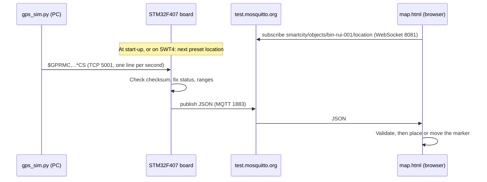

# Smart City: smart waste bin on OpenStreetMap

A smart waste bin reports its GPS location over MQTT. The STM32F407 firmware
publishes the location, and a web page shows the bin on an OpenStreetMap map.
GPS hardware is not needed: a simulator sends NMEA sentences to the board,
like a real GPS module would.



## Smart City object

| Field | Value |
|---|---|
| ID | `bin-rui-001` |
| Type | `waste_bin` |
| Name | `Rui Smart Bin 1` |

Defined in `include/settings.hpp`. The ID is unique because the broker is
public and shared with other participants; the task's example `bin-001` would
collide.

## MQTT topic and payload

Topic:

```
smartcity/objects/bin-rui-001/location
```

Payload (QoS 0, not retained):

```json
{"id":"bin-rui-001","type":"waste_bin","name":"Rui Smart Bin 1","latitude":57.686900,"longitude":11.942600}
```

| Field | Type | Rule |
|---|---|---|
| `id` | string | Must match the map's object ID |
| `type` | string | Object type |
| `name` | string | Human-readable name |
| `latitude` | number | −90 to 90, decimal degrees, 6 decimals |
| `longitude` | number | −180 to 180, decimal degrees, 6 decimals |

The firmware stores coordinates as integer microdegrees
(57.686900° → `57686900`) and formats them to 6 decimals in the JSON. Integers
avoid floating-point rounding, and 6 decimals are about 0.1 m.

## Components

| Part | Files | Role |
|---|---|---|
| Location publisher | `include/location_publisher.hpp`, `src/location_publisher.cpp` | Builds the JSON and publishes it from its own FreeRTOS task, retrying while the broker is unreachable |
| Button presets | `include/location_presets.hpp`, `src/location_presets.cpp` | SWT4 cycles through 3 preset locations in Gothenburg |
| NMEA parser | `include/nmea_parser.hpp`, `src/nmea_parser.cpp` | Turns RMC sentences into microdegrees; integer-only, no FreeRTOS, tested on the PC |
| NMEA TCP receiver | `include/nmea_tcp_receiver.hpp`, `src/nmea_tcp_receiver.cpp` | Listens on TCP port 5001, feeds the parser, publishes at most every 2 s |
| GPS simulator | `smartcity/gps_sim.py` | Sends NMEA RMC sentences to the board |
| Map | `smartcity/map.html` | Leaflet map with OpenStreetMap tiles; subscribes over MQTT WebSockets |
| Tests | `tests/nmea_parser_test.cpp`, `smartcity/test_invalid.sh` | Parser unit tests; invalid messages for the map |

Other firmware changes: `include/location.hpp` (the `Location` type),
`include/settings.hpp` (object and presets), `src/main.cpp` (wiring),
`CMakeLists.txt`, and `max_listeners` raised from 2 to 3 in
`platform/stm32f407/include/stm32f407/keyboard.hpp` for the third button
listener.

## Setup

### Network

The board uses a fixed address `192.168.137.42` with gateway and DNS
`192.168.137.1`, matching Windows Internet Connection Sharing:

1. Connect the board's Ethernet port directly to the PC.
2. On Windows: `ncpa.cpl` → the adapter with internet (e.g. WLAN) →
   Properties → Sharing → tick "Allow other network users to connect…" →
   choose the Ethernet adapter the board is plugged into.
3. The board's LCD shows `ETH on` and `MQTT on` when it reaches the broker.

In the Ubuntu VirtualBox VM, adapter 1 is NAT (internet) and adapter 2 is
bridged to the board's Ethernet adapter, with a fixed address
`192.168.137.10/24` and no gateway.

### Build and flash

```bash
cmake --preset debug
cmake --build --preset debug
openocd -f interface/stlink.cfg -f target/stm32f4x.cfg -c "program build/debug/embedded_workshop.elf verify reset exit"
```

The ST-LINK must be attached to the VM (VirtualBox → Devices → USB).

## Running

### 1. Map

Serve the page from a local web server. Opening the file directly
(`file://`) makes OpenStreetMap block the tiles, because the request has no
website origin.

```bash
cd smartcity && python3 -m http.server 8000
```

Open <http://localhost:8000/map.html>. The status box shows
"Waiting for location of bin-rui-001…" until the first location arrives.

### 2. Location from the board's buttons

After a reset, the board publishes the first preset as soon as MQTT is
connected. Press **SWT4** to move the bin:
Slottsskogen → Götaplatsen → Central Station → Slottsskogen.

### 3. Location from the GPS simulator

```bash
python3 smartcity/gps_sim.py
```

The bin visits Slottsskogen, Götaplatsen, Central Station and Liseberg,
5 seconds each. Liseberg is not a button preset, which shows the data comes
from the GPS path.

Any point can be used:

```bash
python3 smartcity/gps_sim.py --point 57.7065,11.9364
python3 smartcity/gps_sim.py --point=-33.8568,151.2153
```

Negative values need `=`, otherwise the argument looks like an option.

### 4. Watching the messages

```bash
mosquitto_sub -h test.mosquitto.org -t 'smartcity/#' -v
```

MQTT Explorer (connected to `test.mosquitto.org:1883`) shows the same.

## Testing

### Valid locations

| Test | Command | Expected |
|---|---|---|
| Location appears | `mosquitto_pub -h test.mosquitto.org -t smartcity/objects/bin-rui-001/location -m '{"id":"bin-rui-001","type":"waste_bin","name":"Rui Smart Bin 1","latitude":57.6869,"longitude":11.9426}'` | Marker at Slottsskogen |
| Marker moves | Same, with `"latitude":57.6975,"longitude":11.9799` | Marker moves to Götaplatsen |
| Board buttons | Press SWT4 | Marker moves to the next preset |
| GPS simulator | `python3 smartcity/gps_sim.py` | Marker visits 4 points |

### Invalid data (no misleading location)

Invalid data is rejected in three places:

| Where | Input | Result |
|---|---|---|
| Simulator | `--point hello`, `--point 57.7`, `--point 200,11` | Clear error message; nothing is sent |
| Board | `gps_sim.py --no-fix` (status V) | Nothing published; marker stays |
| Board | `gps_sim.py --bad-checksum` | Line dropped; marker stays |
| Board | Latitude above 90°, empty fields | Rejected by the parser (unit tests) |
| Map | Latitude 200, longitude missing, text instead of a number, `0,0`, other object ID, not JSON | ⚠ warning in the status box; marker stays |
| Map | No data yet | "Waiting for location…", no marker |

Run all map cases at once (with the map open):

```bash
./smartcity/test_invalid.sh
```

### Parser unit tests (on the PC)

```bash
g++ -std=c++17 -Wall -Wextra -Iinclude tests/nmea_parser_test.cpp src/nmea_parser.cpp -o nmea_test && ./nmea_test
```

Expected output ends with `All tests passed.`

### Board debug output

The firmware prints to USART3 (header P9, 115200 baud, 8N1), for example
`Location published: {...}`, `GPS simulator connected` and
`GPS: invalid NMEA sentence dropped`. It can be read with the kit's logic
analyzer: GND to P9 GND, CH1 to P9 TX, PulseView with the `fx2lafw` driver,
1 MHz sample rate, UART decoder at 115200 baud on D0.

## Design decisions

- **Integer coordinates.** Microdegrees in `int32_t` format exactly and avoid
  float rounding on the microcontroller.
- **One task per publisher.** `MqttClient::publish` blocks until the MQTT
  agent confirms, so the button handler and the TCP receiver only put the
  location into a one-slot queue (`xQueueOverwrite`). If the broker is down,
  only the newest location is sent when it comes back.
- **Two location sources, one publisher.** Buttons and the GPS receiver both
  call `LocationPublisher::on_location_changed`; the map and the MQTT format do
  not depend on where the location came from.
- **Rate limit.** The GPS receiver publishes at most every 2 s, to be gentle
  with the public broker.
- **Small TCP receive buffer** (1 KB) for the NMEA socket, so the 48 KB
  FreeRTOS heap stays available for MQTT.
- **Validation on every layer.** The board filters bad GPS data; the map also
  validates, because anyone can publish to a public broker. The map builds
  its popup with `textContent`, not HTML, for the same reason.

## Memory use

| Build | FLASH | RAM |
|---|---|---|
| Original firmware | 175 116 B | 80 064 B |
| With location publisher and presets | 176 868 B | 80 160 B |
| With NMEA parser and TCP receiver | 181 564 B | 80 384 B |

The whole feature adds about 6.4 KB of flash (of 1 MB) and 320 B of static RAM.

## Troubleshooting

| Symptom | Fix |
|---|---|
| LCD shows `MQTT off` | Windows sharing stuck: untick and re-tick sharing on the WLAN adapter, or restart the "Internet Connection Sharing (ICS)" service; then reset the board |
| Map tiles say "Access blocked" | Open the map via `http://localhost:8000/map.html`, not as a file |
| Map stays on "Waiting for location…" | Messages are not retained: press reset or SWT4 while the map is open |
| `gps_sim.py`: connection refused | The board is not running the new firmware or `ETH on` is missing: flash again, check `ping 192.168.137.42` |
| `openocd`: `open failed` | The ST-LINK is not attached to the VM: VirtualBox → Devices → USB |

## Broker note

`test.mosquitto.org` is a public test broker: anyone can read and publish on
any topic, and it may be unavailable. No personal or sensitive data is sent;
the demo uses public places in Gothenburg. Check that it is reachable with
`ping test.mosquitto.org` before a demo.

## Future work

- Pothole detection with the board's LSM9DS1 accelerometer (I2C1): publish
  road events with the current location, reusing the same pipeline and map.
- Fill level or temperature of the bin (external temperature sensor on the
  ADC, PB1) in the payload and the popup.
- Retained messages, so the map shows the last location immediately.
- A private broker with TLS and authentication instead of the public one.